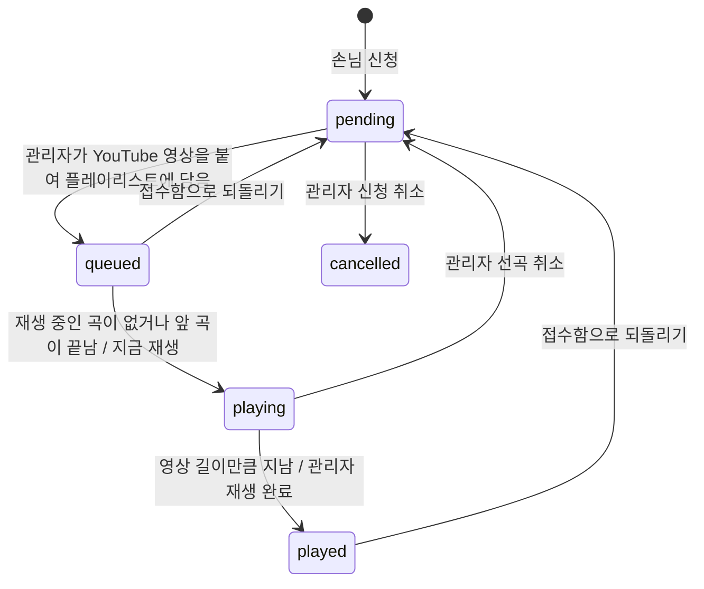
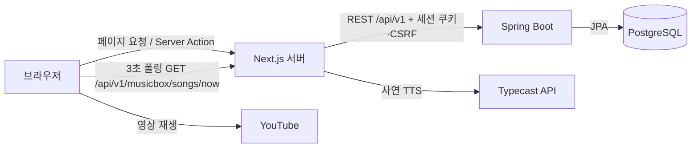
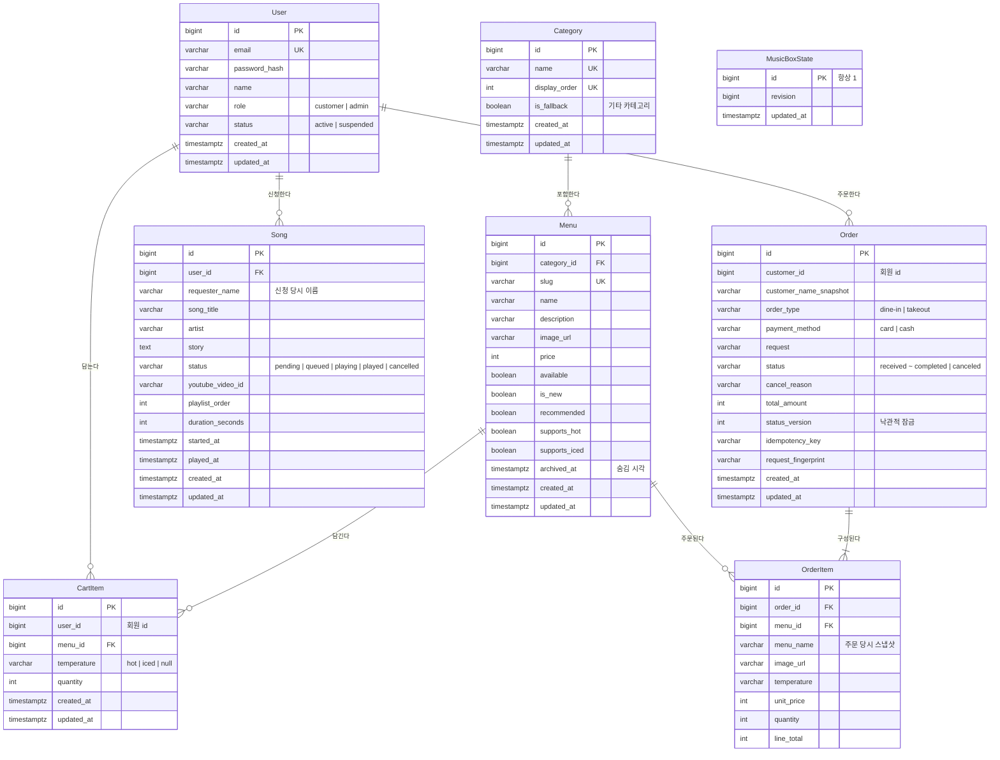

# 삼다방 ☕📻

> 차와 음악이 있는 레트로 다방, **삼다방 (SINCE 1987)**

1970~80년대 다방을 콘셉트로 한 카페 주문·뮤직박스 서비스입니다. 손님은 메뉴를 골라 주문하고, 듣고 싶은 노래와 사연을 신청곡 메모지에 남깁니다. 관리자는 메뉴와 주문을 관리하고, 접수된 신청곡에 YouTube 영상을 붙여 DJ처럼 순서대로 틀어 줍니다. 신청곡은 매장 안 모든 손님 화면에서 같은 곡이 같은 지점으로 흘러나옵니다.

## 주요 기능

### 손님

| 화면 | 기능 |
| --- | --- |
| 홈 `/` | 추천 메뉴, 지금 흐르는 신청곡(DJ 부스)과 다음 차례 사연 3장, 현재 사연 음성으로 듣기 |
| 메뉴 `/menus`, `/menus/[slug]` | 카테고리·검색어·판매 상태·정렬로 찾기, 온도(HOT/ICED)와 수량을 골라 장바구니 담기 |
| 장바구니 `/cart` | 회원별 서버 장바구니. 수량 변경·삭제, 주문할 항목 선택 |
| 주문 `/checkout` | 매장/포장, 카운터 결제수단(카드/현금), 요청사항 입력 후 주문 |
| 주문 내역 `/my/orders` | 진행 중·지난 주문, 상태와 관리자 취소 사유 확인 |
| 뮤직박스 `/musicbox` | 지금 나오는 곡 함께 듣기(볼륨 조절), 신청곡 목록, 신청곡·사연 보내기(고객 회원) |
| 내 신청곡 `/my/songs` | 내가 보낸 신청곡의 진행 상태 확인, 재생 중이 아닌 곡 삭제 |

### 관리자

| 화면 | 기능 |
| --- | --- |
| 관리자 홈 `/admin` | 메뉴 현황, 처리 중 주문 수, 대기 신청곡 수 |
| 회원 `/admin/users` | 회원 검색·조회, 고객 정지/해제 |
| 카테고리 `/admin/categories` | 추가·수정·삭제·순서 변경(삭제 시 메뉴는 `기타`로 이동) |
| 메뉴 `/admin/menus` | 등록·수정·숨김, 첫 개시·추천 표시 |
| 주문 `/admin/orders` | 접수 → 준비 중 → 준비 완료 → 완료 단계 변경과 되돌리기, 접수 단계에서 사유를 적고 취소 |
| 신청곡 `/admin/songs` | 접수된 사연에 YouTube 링크 붙여 플레이리스트에 담기, 순서 변경, 지금 재생·재생 완료·선곡 취소 |

## 뮤직박스는 이렇게 동작합니다



- **곡 넘기기는 서버 시각이 정합니다.** 재생 중인 곡의 `시작 시각 + 영상 길이`가 지나면, 그다음 요청이 들어올 때 서버가 다음 곡으로 넘깁니다(별도 스케줄러 없음). 아무도 보지 않는 사이 여러 곡이 지났으면 한 번에 따라잡습니다.
- **모든 화면이 같은 지점을 듣습니다.** 서버가 내려준 `serverNow`와 `startedAt`으로 재생 위치를 계산하므로, 손님 기기 시계가 틀려도 같은 위치에서 재생됩니다.
- **바뀐 것만 다시 받습니다.** 곡 상태가 바뀔 때마다 `music_box_state.revision`이 오르고, 열린 화면은 3초마다 이 숫자만 비교해 달라졌을 때만 화면을 새로 받습니다.
- **동시 조작을 한 줄로 세웁니다.** 곡을 바꾸는 작업은 `music_box_state` 한 행을 `SELECT ... FOR UPDATE`로 잠근 뒤 처리해, 재생 중인 곡이 둘이 되지 않습니다.

## 기술 스택

| 영역 | 사용 기술 |
| --- | --- |
| 프론트엔드 | Next.js 16 (App Router, Server Actions), React 19, TypeScript 6 |
| 백엔드 | Java 21, Spring Boot 4 (Web MVC, Data JPA, Validation, Security) |
| 데이터베이스 | PostgreSQL |
| 인증 | Spring Security 세션(JSESSIONID) + CSRF 토큰 |
| 외부 연동 | YouTube IFrame Player API, Typecast TTS(사연 읽어 주기) |
| 테스트 | JUnit 5, Testcontainers(PostgreSQL), Playwright, axe-core |

## 아키텍처



- 화면 조회는 서버 컴포넌트가, 변경은 Server Action이 Spring API를 호출합니다. 브라우저는 백엔드 주소를 직접 알지 않습니다.
- `/api/v1/*` 요청은 Next.js rewrites로 백엔드에 전달됩니다.

## ERD

실제 JPA 엔티티 기준입니다. 표기는 엔티티 이름이며, 테이블은 `users`, `categories`, `menus`, `cart_items`, `orders`, `order_items`, `songs`, `music_box_state`입니다.



- `MusicBoxState`는 다른 테이블과 관계가 없는 **단일 행**입니다. 뮤직박스 변경을 직렬화하는 잠금 대상이자, 화면 갱신 신호인 `revision`을 담습니다.
- `CartItem.user_id`와 `Order.customer_id`는 JPA 연관관계 없이 회원 id 값을 저장합니다.
- `OrderItem`은 주문 당시 메뉴 이름·이미지·가격을 복사해 두어, 메뉴가 바뀌거나 숨겨져도 주문 내역은 그대로 보입니다.
- 개념 ERD(Chen 표기법)와 테이블 명세는 [DB 설계 문서](docs/database-design.md)에 있습니다.

## 폴더 구조

```text
3team_ncafe/
├─ frontend/                 Next.js 앱
│  ├─ app/(public)/          홈, 로그인·회원가입, 메뉴, 뮤직박스
│  ├─ app/(customer)/        장바구니, 주문, 마이페이지(주문 내역, 내 신청곡)
│  ├─ app/admin/             관리자 화면
│  ├─ app/_components/       공용 UI (DJ 부스, 플레이어, 볼륨 조절 등)
│  └─ e2e/                   Playwright 시나리오 테스트
├─ backend/                  Spring Boot 앱
│  └─ src/main/java/com/newcafe/backend/
│     ├─ controller/         공개 · my(고객) · admin(관리자) API
│     ├─ service/            도메인별 서비스
│     ├─ entity/             JPA 엔티티
│     └─ repository/         Spring Data JPA
└─ docs/                     설계·연동 문서
```

## 실행 방법

### 1. 백엔드

`backend/.env`에 PostgreSQL 접속 정보를 적습니다. 테이블은 시작할 때 엔티티 기준으로 생성·갱신됩니다(`ddl-auto=update`).

```properties
DB_URL=jdbc:postgresql://localhost:5432/ncafe
DB_USERNAME=...
DB_PASSWORD=...
# 선택: 기본값 http://localhost:3000
CORS_ALLOWED_ORIGINS=http://localhost:3000
```

```bash
cd backend
./gradlew bootRun
# 데모 메뉴를 함께 넣으려면
./gradlew bootRun --args='--spring.profiles.active=seed'
```

### 2. 프론트엔드

```bash
cd frontend
npm install
cp .env.local.example .env.local   # API_ORIGIN=http://localhost:8080
npm run dev                        # http://localhost:3000
```

- `TYPECAST_API_KEY`는 선택입니다. 없으면 사연 음성 듣기만 동작하지 않습니다.
- 로컬에서는 프론트와 백엔드 호스트를 `localhost`로 맞춰야 세션 쿠키가 전달됩니다.

### 3. 관리자 계정

공개 회원가입은 고객 계정만 만듭니다. 로컬에서 관리자가 필요하면 가입한 계정의 역할을 DB에서 바꿉니다.

```sql
update users set role = 'admin' where email = 'admin@example.com';
```

### 테스트

```bash
cd backend && ./gradlew test               # 단위·슬라이스 테스트
cd backend && ./gradlew integrationTest    # PostgreSQL 컨테이너 통합 테스트 (Docker 필요)
cd frontend && npm run lint && npm run typecheck
```

Playwright E2E는 전용 테스트 DB를 쓰며, 절차는 [frontend/e2e/README.md](frontend/e2e/README.md)를 따릅니다.

## 문서

| 문서 | 내용 |
| --- | --- |
| [docs/FRONTEND.md](docs/FRONTEND.md) | 라우트-컨트롤러 매핑, 프론트 개발 규칙, PR 체크리스트 |
| [backend/docs/2026-10-20-backend-blueprint.md](backend/docs/2026-10-20-backend-blueprint.md) | API 계약 |
| [docs/database-design.md](docs/database-design.md) | DB 설계와 개념 ERD |
| [GLOSSARY.md](GLOSSARY.md) | 용어집 |
| [AGENTS.md](AGENTS.md) | Git 브랜치·커밋·PR 규칙 |
