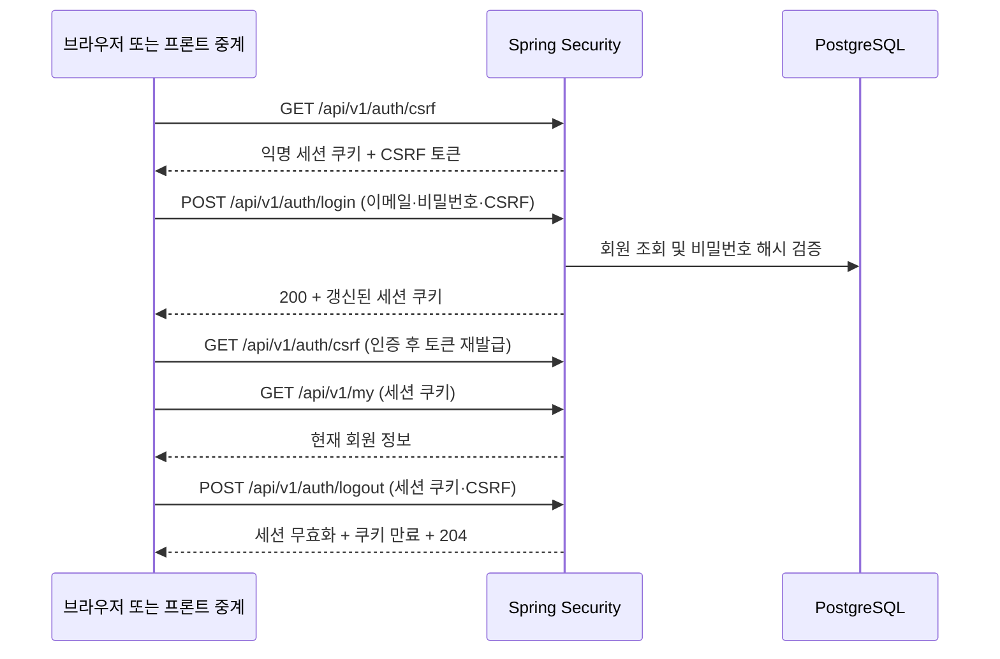

# 회원가입·로그인·로그아웃 백엔드 청사진

작성일: 2026-10-22 · 통합 브랜치: `feature/session-auth` · 최초 기준: `origin/develop` (`62c139a`)

인증 개발은 `feature/session-auth-step0`부터 `step6`까지 한 단계씩 진행한다. 단계별 검증 후 `feature/session-auth` 대상 PR을 만들고, 사람이 통합한다. 구현·검증을 마친 체크박스를 갱신한다. 0단계의 계약과 실행 방법은 [0단계 작업 기록](2026-10-22-auth-step0.md)에 정리한다.

## 1. 목표와 현재 상태

Spring Security로 이메일·비밀번호를 인증하고, 서버 세션과 브라우저 쿠키로 로그인 상태를 유지한다. 회원가입 → 로그인 → 내 정보 확인 → 로그아웃을 실제 PostgreSQL과 연결해 검증하는 것이 목표다.

- 백엔드는 Java 21, Spring Boot 4.1.1, Gradle Groovy DSL, JPA, PostgreSQL을 사용한다.
- 회원 엔티티·저장소·비밀번호 해시와 회원가입 API를 구현했다. 웹 Security·CSRF와 관리자 메뉴·카테고리 접근 제어를 적용했으며, 3단계에서 DB 인증·세션 로그인과 현재 회원 조회를 연결한다.
- 프론트엔드는 현재 목 회원 저장소와 `ncafe_mock_session` 쿠키를 사용한다.
- 데이터 기준은 [DB 설계](../../docs/database-design.md), 기존 경로와 계층 기준은 [백엔드 전체 청사진](2026-10-20-backend-blueprint.md)이다.
- 이번 범위는 공개 회원가입, 로그인·로그아웃, 현재 회원 조회, 세션·CSRF·권한 검사다. 프로필 수정, 관리자 생성·정지 관리 화면, 소셜 로그인, 비밀번호 재설정, 이메일 인증은 후속 작업이다.

## 2. 쿠키와 세션이 맡는 일

| 개념 | 저장 위치 | 이번 구현에서의 역할 |
| --- | --- | --- |
| 세션 쿠키 `JSESSIONID` | 브라우저 | 서버가 발급한 예측하기 어려운 세션 ID를 보관하고 요청에 자동으로 보낸다. 비밀번호·회원 정보·권한은 쿠키에 넣지 않는다. |
| `HttpSession` | 백엔드 서버 메모리 | 세션 ID에 해당하는 로그인 상태와 CSRF 토큰을 보관한다. 서버 재시작 시 사라진다. |
| `SecurityContext` | 인증 후 서버 세션에 저장 | 인증된 principal과 권한을 담고, 다음 요청에서 Spring Security가 복원한다. |
| CSRF 토큰 | 서버 세션 및 클라이언트가 받은 응답 | 쿠키와 별도로 변경 요청의 헤더에 실어 보낸다. 세션 ID를 CSRF 토큰으로 사용하지 않는다. |

세션 저장은 Spring Security에 맡기고 별도의 회원 ID 세션이나 서명 쿠키를 중복으로 만들지 않는다. `SecurityContextHolder`에 인증을 넣는 것만으로 다음 요청의 인증이 보장되지는 않는다. 직접 로그인 Controller를 만들 경우 저장소에 명시적으로 저장해야 하므로, 이번에는 표준 로그인 필터를 사용한다. [공식 세션 문서](https://docs.spring.io/spring-security/reference/servlet/authentication/session-management.html)

CSRF 토큰을 받기 위한 익명 세션과 인증된 세션은 구별한다. 로그인 실패 후 익명 세션 쿠키가 남더라도 인증 성공을 뜻하지 않는다.

## 3. 확정한 구현 기준

기존 DB 계약은 유지한다. 0단계에서 아래 정책을 구현 계약으로 확정한다. 실제 입력 검증과 인증 동작은 이후 해당 단계에서 구현하고 테스트한다.

| 항목 | 기준 |
| --- | --- |
| 회원 필드 | `id`, `email`, `password_hash`, `name`, `role`, `status`, `created_at`, `updated_at` |
| ID·시각 | DB ID는 `BIGINT IDENTITY`, 시각은 `TIMESTAMPTZ`. API ID는 숫자, 시각은 ISO 8601 |
| 이메일 | 앞뒤 공백 제거 후 `Locale.ROOT` 기준 소문자 정규화, 형식 검증, 최대 254자, DB 유니크 제약 |
| 이름 | 앞뒤 공백 제거 후 Unicode 코드 포인트 기준 2~50자 |
| 비밀번호 | Unicode 코드 포인트 기준 최소 8자, UTF-8 기준 최대 72바이트. 앞뒤 공백을 임의로 제거하지 않음 |
| 비밀번호 저장 | `PasswordEncoder`의 단방향 해시만 저장. `DelegatingPasswordEncoder`의 BCrypt를 사용하고 인코딩 식별자까지 저장할 충분한 컬럼 길이 확보 |
| 공개 가입 | `role=customer`, `status=active`를 서버에서 지정. 요청으로 역할·상태를 지정할 수 없음 |
| 회원 상태·권한 | DB 값은 `customer/admin`, `active/suspended`. Security 권한은 `ROLE_CUSTOMER/ROLE_ADMIN`으로 명시적 매핑 |
| 가입 직후 | 가입 API는 계정만 생성. 현재 프론트의 자동 로그인 UX는 향후 가입 성공 후 로그인 API를 별도 호출해 유지 |
| 세션 생성·유지 | `SessionCreationPolicy.IF_REQUIRED`, 로그인 성공 시 세션 ID 변경, 30분 유휴 만료. 자동 로그인·remember-me는 이번 범위에서 제외 |
| 다중 기기 | 여러 세션 허용. 로그아웃은 요청한 세션만 종료하며 전체 기기 로그아웃은 후속 작업 |

비밀번호 해시는 가입과 로그인에서 같은 `PasswordEncoder`를 사용한다. 비밀번호 원문·해시·세션 ID는 API 응답과 애플리케이션 로그에 남기지 않는다. [공식 PasswordEncoder 문서](https://docs.spring.io/spring-security/reference/servlet/authentication/passwords/password-encoder.html)

현재 목 인증의 절대 8시간 만료와 새 세션의 30분 유휴 만료는 다른 정책이다. 브라우저 쿠키가 남아 있어도 서버 세션이 만료되면 재인증해야 한다.

### 쿠키와 브라우저 연결

- 세션 쿠키: `HttpOnly=true`, `Path=/`, `SameSite=Lax`, `Domain` 미지정. 운영 HTTPS는 `Secure=true`, 로컬 HTTP 개발만 `Secure=false`로 구분한다.
- `Max-Age`를 지정하지 않는 세션 쿠키로 시작한다. 인증 유효 기간은 서버의 세션 만료가 결정한다.
- 초기 브라우저 검증은 `http://localhost:3000` → `http://localhost:8080` 직접 호출을 기준으로 한다. 다른 프론트 주소는 설정으로 명시한다.
- 프론트와 백엔드의 호스트 이름을 `localhost`로 통일하고 브라우저 `fetch`에는 `credentials: "include"`를 사용한다.
- CORS는 허용할 프론트 origin·메서드·CSRF 헤더와 credentials를 명시하고, preflight가 인증보다 먼저 처리되게 한다. credentials 사용 시 origin에 `*`를 쓰지 않는다. [공식 CORS 문서](https://docs.spring.io/spring-security/reference/servlet/integrations/cors.html)
- 실제 배포가 서로 다른 사이트라면 쿠키 정책을 배포 구조와 함께 다시 결정한다. 로컬 설정을 그대로 운영에 적용하지 않는다.

## 4. API 계약

모든 변경 요청에는 먼저 받은 익명 또는 로그인 세션 쿠키와 유효한 CSRF 토큰이 필요하다. CSRF 실패는 아래 업무 오류보다 먼저 `403`이 될 수 있다.

| 메서드·경로 | 요청 | 성공 | 주요 실패 |
| --- | --- | --- | --- |
| `GET /api/v1/auth/csrf` | 로그인 불필요 | `200 {headerName, parameterName, token}` | CORS 정책 위반 |
| `POST /api/v1/auth/signup` | JSON `{name,email,password,passwordConfirm}` | `201`, 비밀번호를 제외한 회원 정보. 인증은 하지 않음 | 입력 오류·비밀번호 불일치 `400`, 정규화 이메일 중복 `409` |
| `POST /api/v1/auth/login` | `application/x-www-form-urlencoded`, `email`, `password` | `200`, 회원 정보와 갱신된 세션 쿠키 | 잘못된 자격 증명·정지 계정 `401` |
| `GET /api/v1/my` | 인증 세션 쿠키 | `200`, 현재 회원 정보. 고객·관리자 모두 가능 | 비로그인·만료 세션 `401`, 정지 회원 `403` |
| `POST /api/v1/auth/logout` | 세션 쿠키와 CSRF 헤더 | `204`, 세션 무효화 및 세션 쿠키 만료 | CSRF 누락·불일치 `403` |

회원 응답 필드는 `{id,name,email,role,status}`로 시작한다. 오류는 기존 `ErrorResponse`의 `{code,message}`를 재사용한다. 인증 실패 메시지는 이메일 존재 여부와 정지 여부를 구별해 노출하지 않는다. 인증 응답과 CSRF 응답에는 `Cache-Control: no-store`를 적용한다.

인증이 필요한 조회는 비로그인 시 `401`, 인증은 되었지만 역할이 부족하면 `403`이다. CSRF가 누락된 변경 요청은 비로그인 상태에서도 `403`일 수 있으므로 권한 테스트에는 유효한 CSRF를 붙인다. 로그인 페이지로 `302` 리다이렉트하거나 HTML 오류 페이지를 반환하지 않는다.

로그아웃은 유효한 CSRF가 있으면 익명 상태에서도 `204`로 처리한다. 이미 만료된 세션의 토큰은 유효하지 않으므로, 필요하면 `GET /api/v1/auth/csrf`로 새 익명 토큰을 받은 뒤 요청한다. `GET` 요청은 로그아웃시키지 않는다.

### Spring Security와 Controller의 역할

- 회원가입·CSRF 발급은 `AuthController`, 현재 회원 조회는 `controller/my/UsersController`가 담당한다.
- 로그인은 `formLogin`의 처리 경로와 `usernameParameter("email")`을 설정해 표준 인증 필터가 담당한다. 성공·실패 핸들러는 JSON을 반환한다. [공식 Form Login 문서](https://docs.spring.io/spring-security/reference/servlet/authentication/passwords/form.html)
- 로그아웃은 `logout` 설정과 표준 핸들러로 처리한다. 세션·SecurityContext·저장된 CSRF를 정리하고 `JSESSIONID` 쿠키 만료 및 `204`를 검증한다. [공식 로그아웃 문서](https://docs.spring.io/spring-security/reference/servlet/authentication/logout.html)
- 기존 전체 청사진의 “인증 세 동작 모두 AuthController 소유”를 세분화한 결정이다. 경로는 유지하고 로그인·로그아웃 Controller를 중복 구현하지 않는다.
- `AuthenticationEntryPoint`, `AccessDeniedHandler`, 로그인 실패 핸들러에서도 공통 오류 JSON을 만든다. 필터 오류는 `@RestControllerAdvice`만으로 처리되지 않는다.
- 업무 흐름은 Controller → Service → Repository를 유지하고 Service에 `HttpServletRequest/Response`를 전달하지 않는다.

## 5. 단계별 작업과 완료 기준

### 0단계 — 계약과 실행 기준 확인

- [x] 이메일 로그인, 입력 제한, 가입 후 별도 로그인, 30분 유휴 만료 정책을 이번 구현 기준으로 확정한다.
- [x] `backend/build.gradle`을 빌드 기준으로 사용하고 Java 21·DB 연결·기존 테스트를 확인한다. 로컬의 추적되지 않은 KTS 빌드 파일을 인증 변경에 섞지 않는다.
- [x] `backend/.env`와 실행 디렉터리를 확인하고 실제 DB 호스트·포트로 읽기 전용 연결을 확인한다. 비밀 값은 커밋하지 않는다.
- [x] 테스트용 PostgreSQL과 실제 개발 DB를 분리하고 통합 테스트 초기화가 개발 데이터를 지우지 않게 한다.

완료 기준: 실행 방법과 API 계약을 설명할 수 있고, 기존 `cd backend && ./gradlew test`가 통과한다. 아직 인증 코드는 추가하지 않는다.

### 1단계 — 회원 도메인과 비밀번호 저장

구현과 검증 내용은 [1단계 작업 기록](2026-10-22-auth-step1.md)에 정리한다.

- [x] Boot 관리 버전의 `org.springframework.security:spring-security-crypto`를 먼저 추가한다. 웹 인증 필터는 2단계에서 도입한다.
- [x] `entity/user/User`, 역할·상태 타입, `UserRepository`를 추가한다.
- [x] 이메일 정규화·필수 필드·유니크 제약·생성/수정 시각을 DB 계약에 맞춘다.
- [x] `PasswordEncoder`를 도입하고 평문과 해시가 다르며 `matches`로 검증됨을 확인한다.
- [x] 해시가 Entity 직렬화·`toString`·로그에 노출되지 않게 한다.
- [x] 정규화 이메일 중복, 비밀번호 경계값, 기본 고객 역할·활성 상태를 테스트한다.

완료 기준: 회원을 저장·조회하고 해시로 비밀번호를 검증한다. 실제 PostgreSQL에서도 정규화 이메일 중복 저장이 거부된다.

### 2단계 — Security·CSRF·회원가입의 최소 흐름

구현과 검증 내용은 [2단계 작업 기록](2026-10-23-auth-step2.md)에 정리한다.

- [x] Boot 관리 버전으로 `spring-boot-starter-security`, `spring-boot-starter-security-test`를 추가한다. starter가 제공하는 crypto 의존성의 별도 선언은 정리하고 Security 버전은 별도 고정하지 않는다. [Boot 의존성 기준](https://docs.spring.io/spring-boot/appendix/dependency-versions/coordinates.html)
- [x] `SecurityFilterChain`, 세션 저장 정책, 공통 JSON 오류 핸들러를 추가하고 기본 HTTP Basic 인증을 사용하지 않는다.
- [x] `HttpSessionCsrfTokenRepository`와 `GET /api/v1/auth/csrf`를 구성한다. 지연 토큰을 응답에서 실제로 읽어 저장되게 한다.
- [x] CORS·쿠키 속성을 로컬/운영 환경에 맞게 설정한다.
- [x] `SignupRequest/Response`, `AuthService`, 회원가입 Controller를 추가한다. 입력 검증 후 고객 계정만 저장한다.
- [x] 사전 중복 조회와 DB 유니크 제약을 함께 사용하고 동시 가입 시 한 요청만 성공하게 한다. 이메일 중복에 해당하는 제약 위반만 중복 가입 오류로 변환한다.
- [x] CSRF·가입·로그인 경로는 익명 접근을 허용하되 CSRF 검사를 유지한다. 아직 사용자 조회용 공개 API가 없는 경로를 임의로 `permitAll`하지 않는다.
- [x] 기존 `/api/v1/admin/**`는 관리자 권한으로 보호한다. 로그인 구현 전 기존 MockMvc 테스트는 필요한 테스트 인증과 CSRF를 사용하도록 함께 조정한다.

완료 기준: CSRF 조회 → 쿠키·토큰 전달 → 회원가입이 `201`이며, 세션에는 인증 정보가 없다. 잘못된 입력 `400`, 중복 `409`, CSRF 누락 `403`을 검증한다.

### 3단계 — 로그인과 현재 회원 조회

구현과 검증 내용은 [3단계 작업 기록](2026-10-25-auth-step3.md)에 정리한다.

- [x] `UserDetailsService`와 principal을 만들고 정규화 이메일로 회원을 조회한다.
- [x] `DaoAuthenticationProvider`와 같은 `PasswordEncoder`로 비밀번호를 검증하고 정지 계정을 거부한다.
- [x] 표준 로그인 필터의 경로·이메일 파라미터·JSON 성공/실패 핸들러를 설정한다. 핸들러는 비밀번호를 응답하지 않는다.
- [x] 성공 시 세션 ID 변경과 SecurityContext 저장을 확인한다. 자격 증명 원문이 세션 principal에 남지 않게 한다.
- [x] `GET /api/v1/my`를 구현해 요청 세션의 회원 ID로 본인 정보를 조회한다. 고객·관리자 모두 자신의 정보를 받을 수 있다.
- [x] 로그인 성공 직후 클라이언트가 새 CSRF 토큰을 받게 한다. 로그인으로 이전 토큰이 폐기되는 동작을 테스트한다.

완료 기준: 실제 로그인으로 받은 세션을 다음 요청에 붙이면 `/my`가 `200`이다. 없는 이메일·틀린 비밀번호·정지 계정은 같은 형태의 `401`이며 새 인증을 만들지 않는다.

### 4단계 — 로그아웃·만료·기존 세션의 상태 검사

구현과 검증 내용은 [4단계 작업 기록](2026-10-25-auth-step4.md)에 정리한다.

- [x] `POST /api/v1/auth/logout`을 표준 로그아웃 흐름에 연결하고 성공 시 `204`를 반환한다.
- [x] 서버 세션·인증 정보·CSRF를 정리하고 같은 Path/Domain 조건으로 세션 쿠키를 만료시킨다.
- [x] 유휴 만료·위조 세션 ID·로그아웃 후 과거 세션 ID의 재사용을 차단한다.
- [x] 인증 복원 후 권한 검사 전에 DB의 최신 회원 상태·역할을 확인한다. 삭제된 회원은 인증을 해제하고 `401`, 정지 회원은 해당 요청에 `403` 후 세션을 무효화한다.
- [x] 정지 여부를 principal의 과거 값으로만 판단하지 않는다. 상태 관리 API가 없어도 테스트에서 DB 상태를 바꿔 기존 세션 차단을 검증한다.
- [x] 익명/정지 회원도 유효한 CSRF로 로그아웃할 수 있게 필터 순서를 검증한다.
- [x] 로그인·로그아웃 뒤 CSRF를 다시 조회하는 흐름을 확인한다. CSRF 보호를 전체 비활성화해 해결하지 않는다. [공식 CSRF 문서](https://docs.spring.io/spring-security/reference/servlet/exploits/csrf.html)

완료 기준: 로그아웃 전 세션으로 `/my`를 호출하면 `401`이다. 만료·정지 후에도 회원/관리자 기능을 계속 사용할 수 없어야 한다.

### 5단계 — 기존 API 접근 제어와 통합 검증

- [ ] `/api/v1/admin/**`에 관리자 권한을 적용하고 기존 메뉴·카테고리 기능을 실제 인증과 함께 확인한다.
- [ ] 현재 존재하는 공개 조회 경로만 HTTP 메서드까지 명시해 허용하고 나머지 업무 경로의 인증·권한을 정한다.
- [ ] 고객의 관리자 접근 `403`, 익명의 보호된 조회 `401`, CSRF 실패 `403`을 각각 구별해 검증한다.
- [ ] 관리자 테스트 계정은 테스트 fixture로 만든다. 실제 최초 관리자 초기 설정 명령은 기존 관리자 청사진의 별도 작업으로 두고 공개 가입에 관리자 선택 기능을 추가하지 않는다.
- [ ] MockMvc에서 테스트용 인증 주입만 쓰지 말고, 실제 로그인 요청 → 받은 세션 → 조회 → 로그아웃 흐름도 검증한다.
- [ ] PostgreSQL 통합 테스트로 동시 이메일 중복 가입과 재시작 후 회원 데이터 유지를 확인한다.

완료 기준: 전체 백엔드 테스트가 통과하고 기존 메뉴·카테고리 권한 회귀가 없다. 회원 DB 데이터는 재시작 후 유지되고 메모리 세션은 재인증을 요구한다.

### 6단계 — 프론트 연결은 별도 작업으로 진행

- [ ] 연결 착수 전 `frontend/AGENTS.md`와 `docs/FRONTEND.md`를 읽고 로그인·가입·회원 조회 경로 매핑을 확인한다.
- [ ] 기존 Server Actions를 유지할 때 백엔드 요청에 브라우저의 Cookie·CSRF를 전달하고, 백엔드의 모든 Set-Cookie를 올바른 속성으로 브라우저에 반영하는 중계 계층을 만든다.
- [ ] 서버 `fetch`의 `credentials: "include"`만으로 브라우저 쿠키가 전달된다고 가정하지 않는다. SSR 회원 조회는 Cookie를 명시적으로 전달하고 결과를 공유 캐시하지 않는다.
- [ ] 목 회원 조회와 `createSession/deleteSession`을 백엔드 세션 흐름으로 교체하고 `ncafe_mock_session`을 정리한다.
- [ ] 가입 성공 후 별도 로그인을 호출해 현재 자동 로그인 UX를 유지한다. 가입은 성공했지만 로그인이 실패하면 가입을 재시도하지 않고 로그인 화면으로 안내한다.
- [ ] 숫자 회원 ID에 맞춰 타입과 `/my`의 문자열 ID 표시를 수정한다. `getCurrentUser`와 `requireRole`은 실제 `/my` 응답을 사용한다.
- [ ] 안전한 상대 경로 `next`, 고객 `/`·관리자 `/admin` 이동, 새로고침·다른 탭의 로그아웃 반영을 확인한다.

완료 기준: 브라우저에서 가입 → 자동 로그인 → 새로고침 → 본인 정보 → 로그아웃 → 보호 페이지 재접근을 검증한다. 서버와 브라우저에서 동일한 백엔드 세션을 사용한다.

## 6. 핵심 인수 시나리오

| 번호 | 조건과 동작 | 기대 결과 |
| --- | --- | --- |
| S1 | 유효한 CSRF로 정상 가입 | `201`, `customer/active`, 해시 저장, 아직 비로그인 |
| S2 | 대소문자·공백만 다른 이메일로 가입 | 정규화 후 `409`, 회원 수 증가 없음 |
| S3 | 같은 정규화 이메일로 동시에 가입 | 성공은 한 건, 나머지는 `409` |
| S4 | 입력 경계 위반·비밀번호 확인 불일치 | `400`, 회원 저장 없음 |
| S5 | 익명 세션에서 정상 로그인 후 `/my` 조회 | 로그인 `200`, 세션 ID 변경, 조회 `200`, 비밀번호 노출 없음 |
| S6 | 없는 이메일·틀린 비밀번호·정지 계정 로그인 | 동일한 인증 실패 `401`, 새 인증 없음 |
| S7 | 쿠키 없음·위조·만료·로그아웃된 세션으로 `/my` | `401`, 회원 정보 노출 없음 |
| S8 | 고객/관리자가 관리자 메뉴·카테고리 조회 | 고객 `403`, 관리자 정상 응답 |
| S9 | 가입·로그인·로그아웃에 CSRF 누락·오류 | `403`, 가입·새 로그인·로그아웃 실행 없음 |
| S10 | 정상 로그아웃 후 과거 쿠키를 재전송 | 로그아웃 `204`, 과거 세션의 보호된 조회 `401` |
| S11 | 로그인한 회원을 DB에서 정지 후 보호 API 호출 | 해당 요청 `403`, 인증·세션 정리, 이후 `401` |
| S12 | 로그인/로그아웃 뒤 이전 CSRF로 변경 요청 | 이전 토큰 `403`, 새 토큰 조회 후 정상 처리 |
| S13 | 허용 origin·쿠키·토큰으로 브라우저 요청 | 정상 처리. 허용하지 않은 origin은 CORS 허용 응답 없음 |
| S14 | 서버 재시작 후 이전 세션으로 요청 | 회원 데이터 유지, 메모리 인증 세션은 사라져 재로그인 |

## 7. 진행 원칙

한 번의 구현에서는 한 단계만 진행하고, 완료 기준과 관련 테스트를 통과하면 체크박스를 갱신한다. 보안 설정을 추가해 기존 테스트의 인증 전제가 바뀌는 수정은 같은 단계에 포함한다.

단계 브랜치는 `feature/session-auth-step0`부터 `feature/session-auth-step6`까지 사용하며, 각 단계 착수 시 최신 `feature/session-auth`에서 분기한다. 푸시 전 `origin/feature/session-auth`를 fetch·rebase하고, 충돌이면 abort 후 보고한다. 각 단계는 해당 파일만 커밋 → 푸시 → `feature/session-auth` 대상 PR → 사람이 검토 후 통합하는 순서다. 완료한 단계 브랜치는 삭제하지 않는다.

앞 단계 PR이 미병합이면 그 단계의 검증한 브랜치에서 후속 단계를 분기하고, 해당 브랜치 대상 초안 PR로 변경 범위를 분리한다. 앞 단계를 먼저 `feature/session-auth`에 머지한 뒤 후속 브랜치를 그 위로 rebase하고 PR 대상을 변경한다. 앞 단계 브랜치에 후속 PR을 먼저 머지하지 않는다.

2026-10-25에 갱신한 Git 규칙에 따라 에이전트는 **커밋·푸시·단계 PR 생성까지** 수행한다. 단계 PR과 최종 `feature/session-auth` → `develop` PR의 머지는 모두 사람이 한다. `develop`·`main`에는 직접 커밋·푸시하지 않는다.

**0~2단계는 통합했고, 3~4단계는 구현·검증을 완료해 PR 통합을 기다린다.** 4단계는 3단계에 의존하는 후속 PR이다. 다음 구현은 5단계 기존 API 접근 제어와 통합 검증이다.
