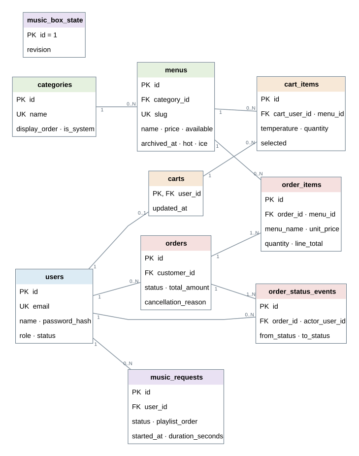
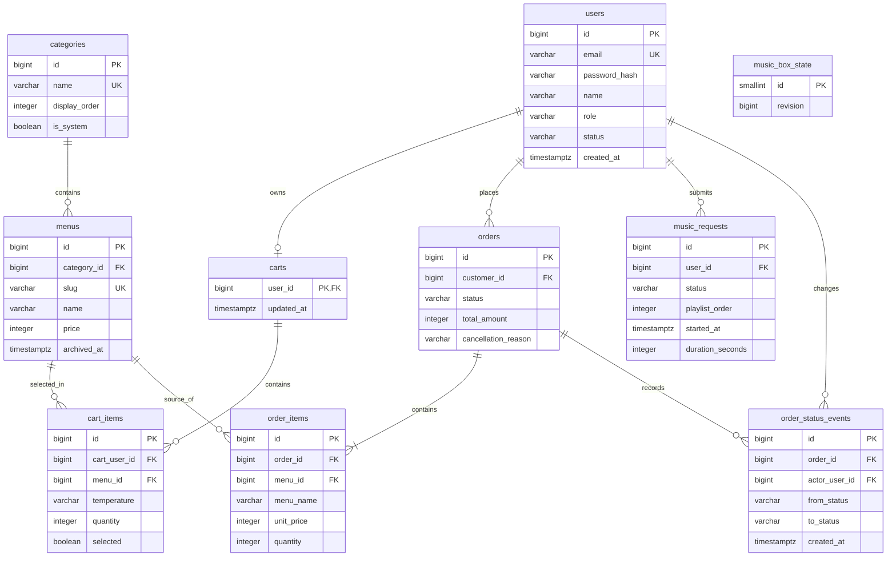

# 삼다방 데이터베이스 설계 초안

기준: 2026-10-20 `origin/develop` (PR #43, #44 포함). 대상 DB는 PostgreSQL이다. 이 문서는 구현 전 데이터 계약이며, 아직 실행 가능한 마이그레이션은 아니다.

## 1. 범위와 결정

| 영역 | 이번 설계에 포함 | 결정 |
| --- | --- | --- |
| 회원 | 가입, 로그인, 프로필 조회·수정, 관리자 목록·상세·정지·해제, 관리자 계정 생성 | 공개 가입은 고객만 가능하다. 관리자 계정은 상태 변경 대상에서 제외한다. 첫 관리자는 초기 설정 절차로 만들고, 이후 관리자가 다른 관리자를 생성한다. |
| 메뉴·카테고리 | 등록·조회·수정·숨김, 검색·필터·정렬, 카테고리 순서 | 메뉴는 카테고리 하나에 속한다. 공개 메뉴 URL에는 고유한 `slug`를 쓴다. 카테고리 삭제 시 소속 메뉴를 `기타`로 옮긴다. |
| 장바구니·주문 | 회원별 장바구니 동기화, 주문, 관리자 상태 변경·취소, 고객 주문 조회 | 고객은 주문을 취소할 수 없다. 관리자는 `received`에서만 사유를 적어 취소한다. 고객은 주문 목록·상세에서 사유를 본다. |
| 뮤직박스 | 신청·삭제, 관리자 선곡·순서·재생·취소, 전체 카페의 현재 곡 | 카페 전체에 대기열과 현재 곡이 하나씩 있다. 재생 중인 신청곡은 회원이 삭제할 수 없다. 반복 모드는 없다. |
| 결제 | 후속 설계 | 주문 페이지는 생기지만 현재 주문 확정 시 결제 없이 `received`가 된다. 결제·결제수단 테이블은 결제사와 연동 흐름이 정해질 때 설계한다. |

기존 목 회원·메뉴·주문·신청곡·브라우저 장바구니는 이관하지 않는다. 시스템 초기 데이터는 보호된 `기타` 카테고리와 운영자가 설정하는 첫 관리자뿐이다. 세트 상품은 구성품 관계 없이 단일 메뉴로 취급한다.

현재 [WBS](https://docs.google.com/spreadsheets/d/14uSQMZDxGkvPw1hTfxbDsvIzxcyETHBFlY8h1oNOil0/edit?gid=0#gid=0)의 고객 주문 취소와 현재 곡 반복 모드는 제외한다. 관리자 주문 관리가 5번과 12번에 중복돼 있으므로 하나의 기능으로 정리한다. 관리자 주문 취소 및 사유 표시, 관리자 계정 생성은 작업 목록에 추가해야 한다.

## 2. ERD

[ERD 이미지 열기](database-erd.svg) · [그림 원본 열기](database-erd.dot)

선 끝의 `1`, `0..1`, `0..N`, `1..N`은 관계의 개수를 뜻한다. `music_box_state`는 다른 테이블에서 참조하는 FK가 없는 단일 제어 행이므로 연결선 없이 표시했다. 아래 Mermaid는 같은 관계를 텍스트로 편집할 때 사용한다.

`music_box_state`는 신청곡의 부모 테이블이나 설정 테이블이 아니다. 단일 행을 잠가 재생·순서 변경을 직렬화하고, 변경 때마다 `revision`을 올려 화면 갱신 여부를 판별한다. 재생 중인 곡은 최대 한 건으로 제한한다.

## 3. 테이블 명세

주요 엔티티의 ID는 내부 식별용 `BIGINT GENERATED ... AS IDENTITY`를 기본으로 한다. 예외로 `carts.user_id`는 회원 ID를 PK로 공유하고 `music_box_state.id`는 고정값 1이다. 손님용 메뉴 상세 조회만 `slug`를 사용한다. 금액은 원 단위 정수이며 음수는 허용하지 않는다. 시각은 `TIMESTAMPTZ`로 저장하고 API에서 ISO 8601로 반환한다.

### 회원과 카테고리

| 테이블 | 필수 컬럼 | 제약 및 읽기 방식 |
| --- | --- | --- |
| `users` | `id`, `email`, `password_hash`, `name`, `role`, `status`, `created_at`, `updated_at` | 이메일은 소문자 정규화 후 유일해야 한다. `role IN ('customer','admin')`, `status IN ('active','suspended')`. 정지된 회원은 새 로그인과 기존 세션의 회원 서비스 접근을 막는다. 관리자 계정의 정지·해제 API는 거부한다. 비밀번호 원문은 저장하지 않는다. |
| `categories` | `id`, `name`, `display_order`, `is_system`, `created_at`, `updated_at` | 이름 유일, 순서 유일. `기타`는 `is_system=true`로 생성하며 이름 수정·삭제를 거부한다. 다른 카테고리를 삭제할 때 해당 메뉴를 `기타`로 옮기고 카테고리를 삭제하는 작업을 한 트랜잭션으로 처리한다. |

첫 관리자의 비밀번호는 소스·마이그레이션에 넣지 않는다. 운영자가 제공한 비밀 값을 읽는 초기 설정 명령으로 만들고, 이후 관리자 전용 계정 생성 기능을 사용한다. 관리자 생성 API는 고객 공개 가입 API와 분리한다.

### 메뉴와 장바구니

| 테이블 | 필수 컬럼 | 제약 및 읽기 방식 |
| --- | --- | --- |
| `menus` | `id`, `category_id`, `slug`, `name`, `name_en`, `description`, `image_url`, `price`, `available`, `is_new`, `recommended`, `supports_hot`, `supports_ice`, `created_at`, `updated_at` | `category_id`는 필수 FK. `slug`는 소문자·숫자·하이픈만 허용하고 전체 메뉴에서 유일하다. 생성 후 변경하지 않는다. `price > 0`. `archived_at`이 있으면 손님 목록·신규 장바구니 추가에서 제외한다. 관리자가 메뉴를 삭제하면 `available=false`, `archived_at=now()`로 숨긴다. |
| `carts` | `user_id`, `updated_at` | 회원당 최대 한 건. 고객 계정만 소유할 수 있도록 서비스에서 검사한다. |
| `cart_items` | `id`, `cart_user_id`, `menu_id`, `temperature`, `quantity`, `selected`, `created_at`, `updated_at` | 같은 장바구니에서 `(menu_id, temperature)` 조합은 한 줄만 둔다. `temperature`는 `hot`, `ice`, `NULL` 중 하나이며 메뉴 옵션과 일치해야 한다. 수량은 1~20. 메뉴명·이미지·가격·판매 가능 여부는 현재 메뉴에서 조회하며 장바구니에 복제하지 않는다. |

PostgreSQL에서는 `NULL` 온도 옵션의 중복도 막아야 한다. 구현 시 `NULLS NOT DISTINCT` 유니크 인덱스가 가능한 버전인지 확인하고, 아니면 `COALESCE(temperature, 'none')` 표현식 인덱스를 사용한다. 메뉴가 숨겨져도 기존 장바구니 줄은 주문 대상에서 제외하고 화면에 판매 중지를 보여준다.

### 주문

| 테이블 | 필수 컬럼 | 제약 및 읽기 방식 |
| --- | --- | --- |
| `orders` | `id`, `customer_id`, `customer_name_snapshot`, `status`, `total_amount`, `status_version`, `created_at`, `updated_at` | 상태는 `received`, `preparing`, `ready`, `completed`, `canceled`. 관리자 취소 시 `cancellation_reason`, `canceled_by`, `canceled_at`을 함께 저장한다. 취소가 아니면 이 셋은 `NULL`. 금액은 0 이상. 고객은 본인 주문만 조회한다. |
| `order_items` | `id`, `order_id`, `menu_id`, `menu_name`, `image_url`, `temperature`, `quantity`, `unit_price`, `line_total` | 주문 당시 데이터의 불변 스냅샷. `quantity > 0`, `unit_price >= 0`, `line_total = quantity * unit_price`. `menu_id`는 과거 메뉴 추적용이며 메뉴 숨김 후에도 주문 조회는 스냅샷으로 가능해야 한다. |
| `order_status_events` | `id`, `order_id`, `actor_user_id`, `from_status`, `to_status`, `created_at` | 최초 접수와 이후 관리자 변경을 기록한다. 고객에게는 현재 상태와 취소 사유를 보여준다. 이벤트 기록과 주문 현재 상태 변경은 같은 트랜잭션에서 수행한다. |

주문 확정은 선택된 장바구니 줄만 대상으로 한다. 서버가 현재 메뉴의 판매 상태·온도 옵션·가격을 다시 확인하고, 클라이언트가 표시한 예상 총액과 다르면 주문을 만들지 않는다. 성공하면 주문·주문 항목·최초 상태 이벤트를 저장하고 주문한 장바구니 줄만 제거한다. 전체 과정은 한 트랜잭션이다.

상태 이동은 `received ↔ preparing ↔ ready ↔ completed`에서 인접한 한 단계만 허용한다. `received → canceled`는 관리자만 가능하며 사유를 필수로 받고 이후 이동은 없다. 고객 취소 API는 제공하지 않는다. 상태 변경 요청은 `status_version` 또는 예상 상태를 함께 받아 다른 관리자의 선행 변경을 감지한다.

### 뮤직박스

| 테이블 | 필수 컬럼 | 제약 및 읽기 방식 |
| --- | --- | --- |
| `music_requests` | `id`, `user_id`, `requester_name`, `song_title`, `artist`, `story`, `status`, `created_at`, `updated_at` | 상태는 `pending`, `queued`, `playing`, `played`, `cancelled`. 선곡 전 `youtube_video_id`·`duration_seconds`는 `NULL` 가능. `queued`에서만 `playlist_order`를 사용한다. `playing`에는 `started_at`, `played`에는 `played_at`을 기록한다. 영상 길이는 0초 초과·6시간 이하. |
| `music_box_state` | `id=1`, `revision`, `updated_at` | 모든 선곡·재생 전환을 한 행 잠금 아래 처리한다. 화면의 버전 확인 API에는 `revision`을 반환한다. |

신청곡 작성은 로그인한 회원만 가능하며 `user_id`는 필수다. `requester_name`은 신청 당시 이름으로 남긴다. 회원은 본인의 곡 중 `playing`이 아닌 곡을 삭제할 수 있다. 관리자가 `pending`을 취소하면 삭제하지 않고 `cancelled`로 남긴다. `queued` 순서는 서로 겹치지 않게 하고, `playing`은 전체 DB에서 최대 한 건으로 제한한다. 재생 상태를 읽거나 바꿀 때 서버가 `started_at + duration_seconds`를 기준으로 경과한 곡을 정리하고 다음 곡의 시작 시각을 계산한다. 길이를 아직 모르면 재생 종료 통지 또는 관리자 조작을 기다린다. `serverNow`와 종료 예정 시각은 API 응답에서 계산하며 저장하지 않는다.

## 4. 인덱스와 동시성

- `users`: 정규화 이메일 유니크 인덱스. 회원관리 화면의 이름·이메일 검색, 역할·상태 필터, 페이지 이동은 DB 쿼리로 처리한다. 이름 부분 검색용 인덱스는 실제 데이터량과 쿼리 계획을 본 뒤 선택한다.
- `categories`: `(display_order)` 유니크. 순서 재배치는 충돌 없이 처리되도록 한 트랜잭션에서 잠금과 임시 순서 또는 지연 가능한 제약을 사용한다.
- `menus`: `slug` 유니크, `(category_id, archived_at, available)` 조회 인덱스. 보관 처리된 메뉴의 slug도 재사용하지 않는다.
- `cart_items`: `(cart_user_id, menu_id, temperature)`의 `NULL` 안전 유니크 인덱스. 장바구니 수정은 해당 회원의 `carts` 행을 잠가 기기 간 동시 수정이 한 순서로 적용되게 한다.
- `orders`: `(customer_id, created_at DESC)`, `(status, created_at DESC)` 인덱스. 상태 변경은 예상 상태·버전을 검사하며 기록한다.
- `music_requests`: `(status, playlist_order)` 조회 인덱스, `queued` 순서 유니크, `playing` 단일 행 보장용 부분 유니크 인덱스. 재생 상태 변경과 `revision` 증가를 한 트랜잭션에서 처리한다.

## 5. 프론트·API 변경 계약

1. 메뉴 등록 폼에 slug 입력·중복 검증을 추가한다. 고객 메뉴 상세 `/menus/{slug}`를 적용한다. 관리자 메뉴·장바구니·주문의 `menuId`와 회원·주문·신청곡 등의 경로 ID를 숫자 ID로 바꾸고, 메뉴 카테고리 선택은 하나로 제한한다.
2. 브라우저 `localStorage` 장바구니를 회원별 서버 장바구니 API로 바꾼다. 기존 목 장바구니는 이관하지 않으며 초기화한다. 가격·판매 상태는 조회 때 현재 메뉴와 결합한다.
3. 주문 페이지를 추가한다. 고객 취소 버튼과 API는 제거한다. 관리자 취소 폼은 `received`에서만 사유를 요구하며 고객 주문 목록·상세에 취소 사유를 표시한다.
4. 새 관리자 회원관리 화면의 검색·필터·페이지 이동·고객 정지/해제를 DB 쿼리와 API로 연결한다. 관리자 생성 화면/API를 추가한다. 관리자 정지/해제는 현재 화면 규칙대로 거부한다.
5. 뮤직박스 API는 `startedAt`, `durationSeconds`, 현재 곡, 버전 정보를 제공한다. 자동 다음 곡 전환은 서버에서 보장하며 반복 모드 API는 만들지 않는다.

## 6. 구현 순서와 검증

1. 이 문서의 데이터 계약을 팀이 확인한 뒤 PostgreSQL 버전과 마이그레이션 도구를 정한다. 보호된 `기타`와 첫 관리자 생성 절차를 준비한다.
2. 회원·카테고리·메뉴 → 장바구니 → 주문 → 뮤직박스 순서로 마이그레이션과 API를 작은 PR로 만든다. 결제 관련 마이그레이션은 만들지 않는다.
3. 각 영역에서 FK/유니크/체크 제약, 트랜잭션, 권한을 검증한다. 특히 두 기기의 동일 장바구니 수정, 두 관리자의 주문 상태 변경, 동시 재생 시작을 확인한다.
4. 화면의 목 저장소를 API로 교체하고 빈 DB에서 관리자 생성 → 카테고리·메뉴 등록 → 장바구니 → 주문 → 선곡까지 확인한다. 기존 목 데이터 이관 스크립트는 만들지 않는다.

참조: `frontend/app/_lib/mock/{users,categories,menus,orders,music-box}.ts`, `frontend/app/_lib/cart/CartContext.tsx`, `frontend/app/_lib/orders/types.ts`, `frontend/app/admin/users/`, `backend/src/main/java/com/newcafe/backend/entity/Menu.java`, WBS.
